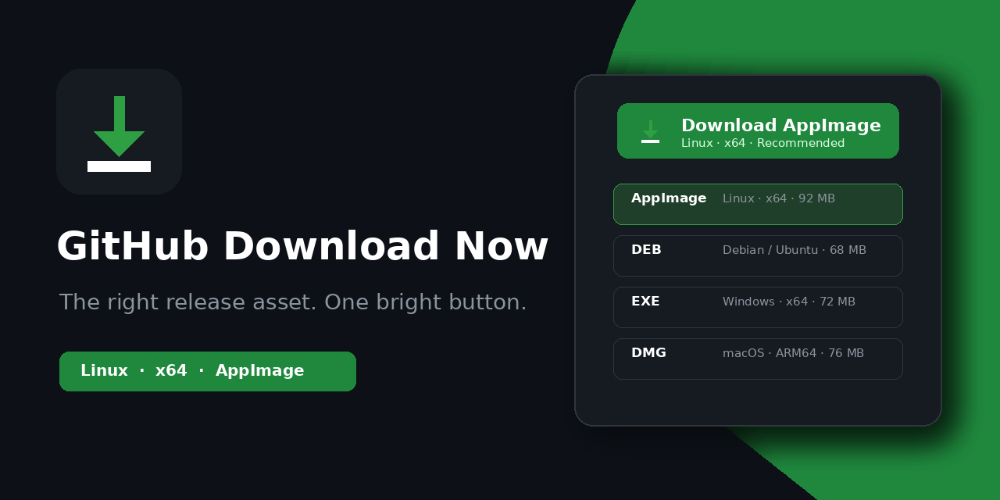

# GitHub Download Now

GitHub Download Now is an open-source browser extension for Chromium and Firefox that helps people download the right application file from public GitHub Releases.

It adds a clear download control to repository pages, detects the current operating system and CPU architecture, recommends a trusted release asset, explains how to install or run it, and can optionally watch selected public repositories for updates.



<p align="center">
  <a href="https://addons.mozilla.org/en-US/firefox/addon/github-download-now/">
    
  </a>
</p>

## Install

### Firefox

**[Install GitHub Download Now from Firefox Add-ons →](https://addons.mozilla.org/en-US/firefox/addon/github-download-now/)**

The official signed build is available for Firefox Desktop and Firefox for Android where add-ons are supported.

For unpacked development builds, see [Install for development](#install-for-development).

## Highlights

- Detects Windows, Linux, macOS and Android release assets.
- Matches x64, x86, ARM64 and ARM filenames.
- Recommends common installers and packages, including EXE, MSI, DMG, PKG, AppImage, DEB, RPM and APK.
- Keeps alternative assets grouped by platform and supports explicit package preferences.
- Places a compact, tag-specific download control beside versions on GitHub Releases pages.
- Lets users switch release versions directly inside the download menu.
- Rejects external or cross-repository links that imitate GitHub Release paths.
- Excludes checksums, signatures, SBOMs, source archives and developer-only Android App Bundles from automatic recommendations.
- Finds dedicated build documents and useful `Building` sections inside README files, including operating-system-specific subsections.
- Follows a small, ranked set of same-repository README links to find component-specific instructions such as `libpiper/README.md`, with depth and API-budget limits.
- Links to original GitHub documentation without inventing or executing commands.
- Shows deterministic installation and launch guidance with copyable commands using the exact filename.
- Keeps optional local download history and opt-in repository watches.
- Rotates background checks in small batches and respects GitHub API rate limits.
- Offers an optional scope-free GitHub connection for a larger API budget; anonymous public-only mode remains fully available.
- Uses an original purple repository-branch/download mark while keeping green for successful download actions.
- Supports Russian and English interfaces.

## Download several release assets

Open a release's download menu and choose **Download several files**. The separate extension page lists all uploaded assets for that tag, including checksums and signatures that are excluded from automatic recommendations. Filter by one or more extensions (including `.tar.gz`), search filenames, select individual files or all visible files, then download or copy the selected links.

The browser asks for the optional `downloads` permission on the first download. The queue runs in the background with up to three active files, saves its state locally, shows per-file results and can retry errors or cancel remaining work. Files use a separate folder per queue inside the browser's download directory. Clearing the queue removes its local metadata; it does not delete downloaded files.

Bulk downloads require a positively verified public repository, use anonymous GitHub API requests, and are unavailable in private/incognito contexts. Releases with more than 500 uploaded assets show a limit error rather than an incomplete list. GitHub's automatically generated source ZIP/TAR archives remain separate links in the release menu. Bulk queues do not create installation prompts or download-history entries. After a successful file, one repository-level button lets you explicitly opt into update tracking; queues never add watches automatically.

## Privacy and security

The extension has no analytics, advertising, AI service, developer-operated backend or remote executable code.

GitHub Download Now supports public repositories only and fails closed when GitHub does not expose a positive public-repository marker. It reads public release data already present on the current GitHub page and may make anonymous requests to public `github.com` pages. The official GitHub REST API is used as a fallback, for user-requested build-document discovery and for opt-in update checks. Page requests omit GitHub session credentials.

Users may optionally connect GitHub through the official OAuth Device Flow with no requested scopes. This raises the API budget for public requests but does not enable private-repository support. The token stays in `storage.local`, is never synchronized or sent to the developer, and its local copy can be removed with **Disconnect**. Full server-side revocation remains available in GitHub Settings → Applications. Browser extension storage is not an encrypted credential vault; see the complete policy before enabling the connection.

Release and source URLs are accepted only when their origin, repository and path match the expected GitHub resource. Download history, watched repositories and rate-limit scheduling metadata stay in `storage.local`; preferences may be synchronized by the browser through `storage.sync`.

See [PRIVACY.md](PRIVACY.md) for the complete policy and Limited Use disclosure.

## Browser support

- Chromium 121 or newer: Chrome, Edge, Brave, Vivaldi and other compatible browsers.
- Firefox 140 or newer.
- Firefox for Android 142 or newer where add-ons are supported.

Android in the feature list means the extension can recognise APK/APKS/AAB release assets. Regular Chrome for Android does not install desktop Chrome extensions.

## Install for development

### Chromium

1. Extract `github-download-now-chromium-v1.3.0.zip`.
2. Open `chrome://extensions`.
3. Enable **Developer mode**.
4. Choose **Load unpacked**.
5. Select the extracted directory containing `manifest.json`.

### Firefox

1. Extract `github-download-now-firefox-v1.3.0.zip`.
2. Open `about:debugging#/runtime/this-firefox`.
3. Choose **Load Temporary Add-on**.
4. Select `manifest.json`.

The temporary installation above is intended for development. For normal use, install the signed build from [Firefox Add-ons](https://addons.mozilla.org/en-US/firefox/addon/github-download-now/).

## Languages

The extension ships with English and Russian. Interface text uses the standard WebExtensions `_locales` format, and unsupported browser languages fall back to English.

Adding a translation does not require changing application logic. Copy the English catalog, translate its `message` values and run the locale validator. See [Translating GitHub Download Now](docs/TRANSLATING.md).

## Development

The exact reviewer-oriented build procedure is documented in [BUILDING.md](BUILDING.md).

Requirements:

- Node.js 20.19+, 22.13+ or 24+;
- Python 3.13 for UI tests;
- Playwright from `requirements-dev.txt`.

```bash
npm ci --ignore-scripts
npm run verify
```

`npm run verify` runs locale/project validation, architecture-boundary checks, ESLint, automatically discovered unit tests, JavaScript syntax checks, reproducible packaging and Firefox add-on linting. Full browser UI checks:

```bash
python3 -m venv .venv-ui
source .venv-ui/bin/activate
python -m pip install -r requirements-dev.txt
python -m playwright install chromium firefox
GHDN_UI_BROWSERS=chromium,firefox npm run test:ui
```

The release workflow runs both verification groups again before publishing artifacts with signed build-provenance attestations.

Build directories:

```text
dist/chromium/
dist/firefox/
```

The build uses an explicit source-file allowlist. Unknown files in `src/` fail validation instead of silently entering store packages. Release ZIP timestamps derive from `SOURCE_DATE_EPOCH` or the current Git commit for reproducible builds.

## Permissions

- `storage`: saves settings and optional local update-tracking data.
- `alarms`: schedules batched checks for explicitly watched repositories.
- `notifications` (optional): displays update notifications only after the user enables them.
- `downloads` (optional): starts bulk downloads and checks results for this extension's queue.
- `https://github.com/*`: displays the interface on public repository pages and, only after an explicit connection action, uses GitHub's official OAuth Device Flow endpoints.
- `https://api.github.com/*`: requests public release metadata, build documents, rate-limit status and watched-repository updates.

The extension does not request cookie or browsing-history permissions. The optional `downloads` permission technically allows broader access to browser downloads; the implementation searches only its own queue IDs or unique queue filenames. Optional GitHub authentication is initiated only from settings, requests no OAuth scopes and is disclosed in [PRIVACY.md](PRIVACY.md).

## Supply-chain verification

Release workflows create SHA-256 checksums and signed GitHub artifact attestations. A downloaded release can be checked with:

```bash
sha256sum -c SHA256SUMS-v1.3.0.txt
gh attestation verify github-download-now-chromium-v1.3.0.zip -R ITDruss/github-download-now
```

## Contributing

Reports of incorrect recommendations are especially useful. Include the public repository URL, detected platform, selected asset and expected asset.

Before changing code, read the [contributing guide](.github/CONTRIBUTING.md), [development task map](docs/DEVELOPMENT.md) and [architecture reference](docs/ARCHITECTURE.md). Translation-only contributions are documented separately in [TRANSLATING.md](docs/TRANSLATING.md).

## Disclaimer

GitHub Download Now is an independent open-source project and is not affiliated with or endorsed by GitHub, Inc. GitHub is a trademark of GitHub, Inc.

## License

MIT
